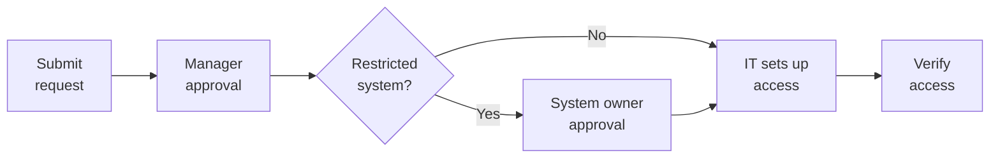

# How to Request Software Access

Use this guide when you need access to a software application, a licence, or extra permissions. It covers how to submit a request, who approves it, and how to check that access works.


Before you request anything, check whether the software is already available in the company software portal. See **Tools and Software**.


| Owner         | Document type | Version | Last updated    |
| ------------- | ------------- | ------- | --------------- |
| IT Department | How-to guide  | 1.0     | 29 October 2026 |

### What Are You Requesting?

| If you need...                                   | Choose this request type |
| ------------------------------------------------ | ------------------------ |
| A new application for your job                   | New Application Request  |
| A paid licence for a software product            | License Request          |
| Access to an approved platform or online service | Software Access          |
| More permissions in an app you already use       | Application Permissions  |
| Software installed on your company device        | Software Installation    |

Your request type also applies when your role changes or when an existing licence or permission needs to be renewed or changed.

### Before You Start

Have these ready:

* Your company username or email address
* The name of the application
* A clear business reason for needing it
* Your department and reporting manager
* The access level you need, if you know it


Paid or specialized software may need extra approval from your manager, the software owner, IT, or the budget owner. Allow more time for these requests.


### Request Process



#### Check what is already available

Look in **Tools and Software** and the software portal. If you are not sure which tool or licence you need, ask your manager or IT Support.



#### Open the request portal

Go to the helpdesk portal at https://helpdesk.vctechnologies.example, sign in with your company account, and choose the request type from the table above.



#### Fill in the form and submit

Complete the fields in the table below, check that the application name and your reason are correct, and submit. Write down your ticket number.



#### Wait for approval

The people listed in the approval table will review your request. It stays pending until every approval is in.



#### IT sets up your access

IT checks availability and licensing, then creates your account, assigns the licence or permissions, or installs the software. Processing times vary.



#### Check that it works

Open the application, sign in with your company account, complete MFA, and make sure you have the permissions you asked for. If not, contact IT Support with your ticket number.




Do not install unapproved software, buy licences yourself, or work around the approval process.


### Request Form Details

| Field            | What to enter              | Example                                |
| ---------------- | -------------------------- | -------------------------------------- |
| Application name | The exact name of the tool | Jira                                   |
| Request type     | One of the types above     | Software Access                        |
| Business reason  | Why you need it            | Track tasks for the documentation team |
| Access level     | The permission you need    | Standard user                          |
| Manager          | Your reporting manager     | Name of your manager                   |
| Project or team  | Where you will use it      | Documentation team                     |


Enter only what the form asks for. Never include passwords, MFA codes, or other secrets.


### Who Approves Requests

| Approver                    | When approval is needed                           |
| --------------------------- | ------------------------------------------------- |
| Reporting manager           | Every request                                     |
| IT Department               | Every request                                     |
| Application or system owner | Apps with restricted data or administrator rights |
| Information Security        | Sensitive or higher-risk access                   |
| Finance or procurement      | Paid licences                                     |

### Request Status

| Status              | What it means                                           | What to do                                                |
| ------------------- | ------------------------------------------------------- | --------------------------------------------------------- |
| Submitted           | Your request has been received                          | Nothing, just wait                                        |
| Pending approval    | Waiting for one or more approvers                       | Remind the approver if it is delayed                      |
| In progress         | IT is setting up your access                            | Nothing, just wait                                        |
| Completed           | Access is ready                                         | Verify it works (step 6)                                  |
| On hold or rejected | More information is needed, or the request was declined | Read the ticket comments and reply, or contact IT Support |

If a request stays pending longer than expected, check its status in the helpdesk portal or contact IT Support with your ticket number.

### Troubleshooting

I cannot find the software in the portal

It may not be approved for your role or device. Submit a **New Application Request** and explain why you need it.

My request has been pending for a long time

Check the ticket to see who the approval is waiting for. Ask that person, or contact IT Support with your ticket number.

My request was approved but I cannot sign in

Complete MFA when asked, and sign out and in again. If it still fails, contact IT Support with the application name and the error message.

I have the wrong permissions

Submit an **Application Permissions** request that names the exact access level you need.

### Access Rules


Request only the access your role needs, never share application accounts, and report unexpected permissions to IT Support. Access can be reviewed or removed when your role changes. See the **Access Control Policy**.


### Contact IT Support

Contact IT Support if you cannot submit a request, are unsure what you need, your request is blocked or delayed, an application will not install, or you cannot reach it after approval.

| Contact         | Details                                  |
| --------------- | ---------------------------------------- |
| Email           | it-support@vctechnologies.example        |
| Helpdesk portal | https://helpdesk.vctechnologies.example  |
| Support hours   | Monday to Friday, 9:00 AM to 6:00 PM IST |


In your message, include your ticket number, the application name, a short description of the problem, and any error message. Never include passwords or MFA codes.

