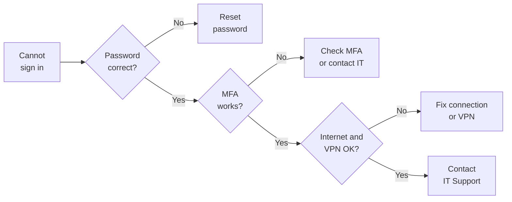

# How to Troubleshoot Login Issues

Use this guide when you cannot sign in to your company account, an application, or an internal system. Find your problem in the table first, then work through the steps in order. Stop as soon as you can sign in.


Avoid repeated sign-in attempts. Too many failures can lock your account.


| Owner         | Document type | Version | Last updated    |
| ------------- | ------------- | ------- | --------------- |
| IT Department | How-to guide  | 1.0     | 29 October 2026 |

### Find Your Problem

| What you see                                      | Likely cause                                     | What to try first                                                                      |
| ------------------------------------------------- | ------------------------------------------------ | -------------------------------------------------------------------------------------- |
| Incorrect username or password                    | Typo, Caps Lock, or an expired password          | Check your details. If you forgot it or it expired, see **How to Reset Your Password** |
| Account locked or disabled                        | Too many failed attempts, or an inactive account | Stop trying and contact IT Support                                                     |
| MFA code not accepted, or no prompt arrives       | Phone offline, or the wrong method               | Check your phone's connection and authenticator app, or use another method             |
| The login page will not load                      | Network or VPN problem                           | Check your internet, then connect the VPN (see **How to Configure VPN**)               |
| You sign in, but see "access denied"              | Missing permission or licence                    | Follow **How to Request Access**                                                       |
| Repeated sign-in prompts, or sessions that expire | Browser cache or cookies                         | Try a private window (step 5 below)                                                    |
| One application will not sign you in              | Application problem or service outage            | Check the IT status page, then contact IT Support                                      |


**Got an MFA request you did not start?** Do not approve it. Report it to IT Support or the security team straight away, because someone may have your password.


### Quick Decision Guide

### Troubleshooting Steps



#### Check your credentials

Make sure you are using your company username or email on the official sign-in page. Look for typing errors, extra spaces, and Caps Lock, then try once more.



#### Reset your password if needed

If you forgot it or it has expired, use the official reset page and follow **How to Reset Your Password**. Use only the approved recovery process.



#### Check multifactor authentication (MFA)

Use your registered method and check that your phone or authenticator app is online. If you have another approved method, try it. If you lost your device, contact IT Support for identity verification.



#### Check your connection

Open a public website to confirm that your internet works. If the system needs the VPN, connect with the approved configuration (see **How to Configure VPN**) and try again.



#### Rule out the browser

Refresh the page, restart the browser, and check that it is up to date. If company policy allows, try a private window. If that works, the problem is probably stored cookies or cache for that site. Clearing them may sign you out of other services.



#### Check your access and service status

Confirm that you are using the right company account and that the application is meant for your role. If you need extra permission, follow **How to Request Access**. If several services are down, check the IT status page and ask a colleague whether they see the same thing. Do not keep changing your password during an outage.




Never disable security extensions, endpoint protection, or browser security settings to fix a login problem. Do not use another employee's account either.


### More Help

I lost my phone or my authenticator app

Contact IT Support. They will verify your identity and help you set up MFA again. Do not try to work around it.

It works in a private window but not in my normal browser

Your normal browser probably holds old cookies or cached data for that site. Clearing them for that site alone should fix it. On a managed browser, follow company guidance first.

My account still shows as locked

Wait for any lockout timer to end, then try again once. If it stays locked, contact IT Support. Do not keep retrying.

### Security Rules


* Use only official company sign-in pages.
* Never share your password, MFA codes, recovery codes, or tokens.
* Never approve an MFA prompt you did not start.
* Report suspicious sign-in notifications or a suspected account compromise promptly.


If you suspect that your account has been compromised, contact IT Support or the security team immediately and follow their instructions.

### Contact IT Support

Contact IT Support if you cannot sign in after these steps, your account is locked or inactive, you cannot finish password recovery or MFA, errors keep appearing, you lack access you should have, several services are down, or you suspect unauthorized access.

| Contact         | Details                                  |
| --------------- | ---------------------------------------- |
| Email           | it-support@vctechnologies.example        |
| Helpdesk portal | https://helpdesk.vctechnologies.example  |
| Support hours   | Monday to Friday, 9:00 AM to 6:00 PM IST |
| Security issues | security@vctechnologies.example          |


In your ticket, include your username or email, the application, the time of the problem, the exact error message, what you already tried, and your device operating system and browser. Never include passwords, MFA codes, or recovery codes.

