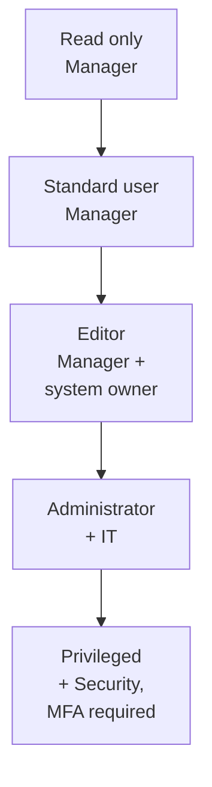

# Access Control Policy

This policy sets the rules for granting, managing, reviewing, and removing access to VC Technologies systems, applications, devices, networks, and information. It applies to all employees, contractors, administrators, system owners, and other authorized users.


The company follows the principle of **least privilege**: you get only the access your job needs, and nothing more. To request access, see **How to Request Access**.


| Policy details     |                                      |
| ------------------ | ------------------------------------ |
| Owner              | IT / Information Security Department |
| Policy type        | IT policies and standards            |
| Version            | 1.0                                  |
| Effective date     | 29 October 2026                      |
| Last reviewed      | 29 October 2026                      |
| Next review        | 29 October 2027                      |
| Approval authority | Chief Information Security Officer   |

### Who This Applies To

The policy covers employee accounts, email and collaboration platforms, business and cloud applications, managed devices and servers, internal networks and remote access, shared folders and file storage, databases, development environments and code repositories, administrative accounts, and customer and other confidential data. It applies to employees, contractors, temporary staff, and third-party service providers.

### Access Principles

* **Least privilege:** you get only the permissions your job needs.
* **Need to know:** confidential information goes only to people who need it.
* **Role-based access:** access is assigned by role, department, or function.
* **Separation of duties:** critical tasks are split between people where needed.
* **Accountability:** every action can be traced to a person or an approved account.

### Access Levels


Do not share your account, ask for access outside the approval process, or try to get higher permissions by bypassing access controls.


### How Access Is Granted



#### Submit a request

You or your manager submit a request in the helpdesk portal (https://helpdesk.vctechnologies.example). Include your name, role, the system, the permission level you need, and the business reason.



#### Get approval

The request is reviewed by the right approvers: your manager, the system owner, IT, Information Security, or the data owner. Privileged and sensitive access needs extra approval.



#### IT verifies the request

IT confirms that the user is authorized, the reason is valid, the permissions are appropriate, and all approvals are in place. Incomplete requests are sent back.



#### Access is set up

IT or the system owner creates the account, assigns the role or permissions, adds any licence or authentication controls, and records the change. Access is never granted before approval, except through the approved emergency process.



#### Check that it works

You confirm that you can reach the resource at the right permission level and that nothing extra was granted.



### Account Lifecycle



* Accounts are created only for authorized users, after identity checks.
* Access matches the job role and the approved requirements.
* Initial credentials are delivered securely, and required authentication controls are set up.



When you change department, role, or project:

* Your access needs are reassessed.
* Permissions you no longer need are removed.
* New permissions need approval before they are granted.



Access is removed when you leave, a contract ends, a temporary assignment is finished, or an account may be compromised. IT and HR work together on this through the offboarding process, and access is removed by the last working day.



### Detailed Rules

Privileged and administrator accounts

These accounts can make large changes, so they have extra controls.

* Grant them only for a business or technical need, with approval.
* Use separate standard and administrator accounts where required.
* Turn on MFA, and never share or store the credentials in unsecured places.
* Use them only for authorized administrative work, and log the activity where supported.
* Review privileged access regularly.

Contractors and third parties

* Access needs an approved business reason from the owner of the system.
* It is limited to what the engagement needs and has a set duration or review date.
* It follows the same authentication and security controls as staff access.
* It is removed promptly when the engagement ends.
* Third parties must follow contractual, confidentiality, and security requirements.

Temporary and emergency access

Temporary or emergency access needs a clear reason, approval from an authorized person, a defined scope and end date, monitoring, and a record of what was done. It is removed when the need ends and is reviewed afterwards where required. It must never become a permanent way around the normal approval process.

Authentication and sign-in security

Use only your own account, protect your credentials, use MFA where required, lock your device when you leave it, and report suspicious sign-in attempts. See the **Password Policy**.

Logging and monitoring

Where supported, the company logs account changes, permission and role changes, privileged activity, failed or suspicious sign-ins, access to sensitive resources, and emergency access. Logs are protected from unauthorized changes and kept according to the retention rules. Report suspected unauthorized access through the security incident process.

### Access Reviews

Access is reviewed on a schedule to check that it is still needed.

| Access type                         | Review frequency                            |
| ----------------------------------- | ------------------------------------------- |
| Privileged and administrator access | Every quarter                               |
| Standard employee access            | Every six months                            |
| Contractor and third-party access   | Every quarter, and when the engagement ends |

### Responsibilities

| Role                   | Responsible for                                                                                                                                  |
| ---------------------- | ------------------------------------------------------------------------------------------------------------------------------------------------ |
| Employees and users    | Using only their own authorized accounts, protecting credentials, requesting access through approved channels, and reporting unauthorized access |
| IT Department          | Carrying out approved requests, managing accounts, keeping access records, applying technical controls, and removing access when authorized      |
| Managers               | Confirming business need, approving requests within their authority, telling IT about role changes and departures, and taking part in reviews    |
| System and data owners | Defining access levels, approving access, reviewing permissions on schedule, and making sure restrictions match business and security needs      |
| Information Security   | Setting access control standards, advising on risk, and leading investigations into suspected unauthorized access                                |

### Violations and Exceptions


Unauthorized access, misuse of privileges, account sharing, or deliberately bypassing access controls may lead to corrective or disciplinary action, in line with company procedures and the law.


### Related Pages


[company-policies.md](../getting-started/company-policies.md)



[access-control-policy.md](access-control-policy.md)

